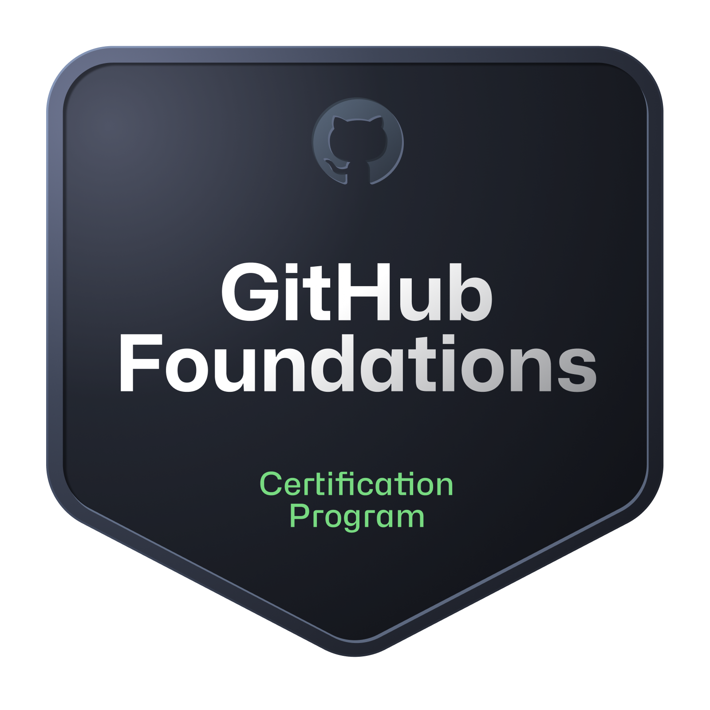
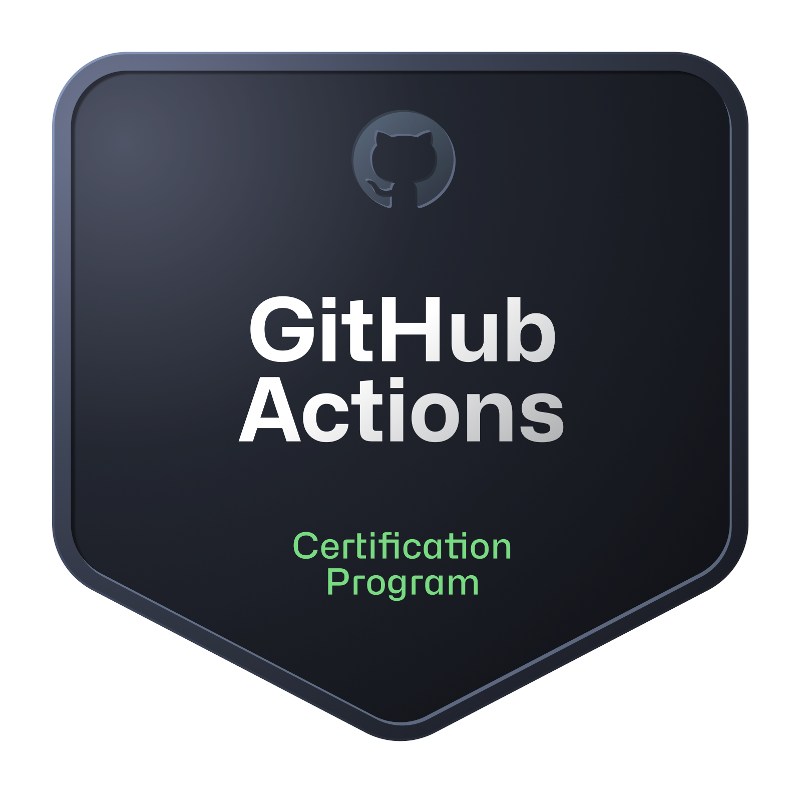

<a href="https://github.com/elianisdev">🇺🇸 English</a> · 🇪🇸 Español

<h1 align="center">Hola 👋, soy Eliana Suancha Guzmán</h1>
<h3 align="center">Desarrolladora Frontend Semi Senior · React · Next.js · TypeScript</h3>

  
  
  

Desarrolladora Frontend de Colombia con más de 5 años de experiencia construyendo aplicaciones web con React, Next.js y TypeScript. Convierto diseños de Figma en interfaces responsive y accesibles con componentes reutilizables, integro APIs REST y construyo formularios complejos con validaciones. He trabajado en productos para empresas de reclutamiento, banca y automotriz, colaborando con equipos de backend en Node.js y NestJS.

- 🌐 **Portafolio:** [eliana-suancha-dev.vercel.app](https://eliana-suancha-dev.vercel.app/es), bilingüe, hecho con Next.js 16, CI con GitHub Actions y despliegue continuo en Vercel
- 💼 **Recientemente:** frontend de una plataforma de reclutamiento (ATS) y su sitio comercial en **Datta**
- 🚧 **Construyendo en público:** [DevFlow AI](https://github.com/elianisdev/devflow-ai), un tablero donde cada tarea se conecta con su pull request y agentes de IA revisan el código
- 📜 **Certificada** en GitHub Foundations y GitHub Actions
- 🎓 Estudiante de **Ingeniería de Software** en la Universidad Manuela Beltrán
- 🤖 Uso agentes de IA (Claude Code) como apoyo en el desarrollo, siempre revisando y probando mi trabajo
- 🌎 Disponible para posiciones frontend **remotas** y proyectos freelance
- 📫 **Contacto:** elianitasuanguz@gmail.com

### ✨ Logros destacados

- Desarrollé **5 módulos completos** de un ATS (contrataciones, plantillas de correo, acciones automatizadas y panel de reclutadores freelance) con React 19, TypeScript strict, TanStack Query, React Hook Form, Zod y Zustand
- Creé un encabezado reutilizable para el design system (shadcn/ui + Tailwind CSS 4), **adoptado después en 19 componentes existentes**
- Integré **Gmail mediante Google OAuth** y una página de agendamiento con **cal.com**
- Construí **gestión documental y firma digital** para clientes bancarios con AWS S3 y Adobe PDF Services
- Implementé la **internacionalización español / inglés** con Lingui
- Escribí pruebas unitarias y E2E con Jest, React Testing Library, Playwright y Cypress

### 💼 Experiencia

| Empresa | Rol | Periodo |
|---|---|---|
| Datta | Frontend Developer (React / Next.js) | 2026 |
| Comunidades tech (No Country, iGrowker, FooTalent) | Frontend Developer (React) | 2025 – 2026 |
| TechyWe | Software Developer (React / Next.js / React Native) | 2022 – 2025 |
| CasaToro Automotriz | Frontend Developer (React / Vue) | 2022 |
| Software Corporation | Web Frontend Developer (React) | 2021 – 2022 |
| Tongo Design | Web Developer (migración de Vue a React) | 2020 |

### 🛠️ Tecnologías

  

**También:** React Native · shadcn/ui · SQL Server · MariaDB · Materialize · TanStack Query · Zustand · React Hook Form · Zod · Jest · React Testing Library · Playwright · Cypress · WebSockets · Bitbucket · Bruno

**Prácticas:** Clean Architecture · Atomic Design · Accesibilidad (WCAG) · Core Web Vitals · Scrum · GitHub Flow

### 📜 Certificaciones

  
  

### 🔥 Racha en GitHub

