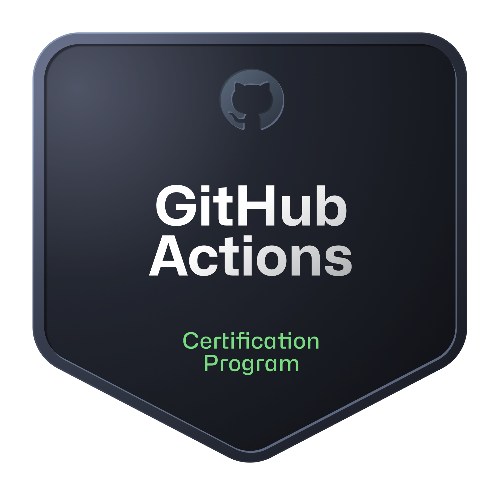

<h1 align="center">Hi 👋, I'm Eliana Suancha Guzmán</h1>
<h3 align="center">Semi Senior Frontend Developer · React · Next.js · TypeScript</h3>

  
  

Frontend Developer from Colombia with 5+ years of experience building web applications with React, Next.js and TypeScript. I turn Figma designs into responsive, accessible interfaces and reusable components, integrate REST APIs and build complex forms with validation. I have worked on products for recruitment, banking and automotive companies, collaborating with backend teams using Node.js and NestJS.

- 🌐 **Portfolio:** [eliana-suancha-dev.vercel.app](https://eliana-suancha-dev.vercel.app), bilingual, built with Next.js 16, CI with GitHub Actions and continuous deployment on Vercel
- 💼 **Recently:** frontend for a recruitment platform (ATS) and its marketing site at **Datta**
- 🚧 **Building in public:** [DevFlow AI](https://github.com/elianisdev/devflow-ai), a task board where each task is linked to its pull request and AI agents review the code
- 📜 **Certified** in GitHub Foundations and GitHub Actions
- 🤖 I use AI agents (Claude Code) as development support, always reviewing and testing my work
- 🌎 Open to **remote** frontend roles and freelance projects
- 📫 **Contact:** elianitasuanguz@gmail.com

### Tech stack

  

**Also:** React Native · SQL Server · TanStack Query · Zustand · React Hook Form · Zod · Jest · Playwright · Bruno

### Certifications

  
  

